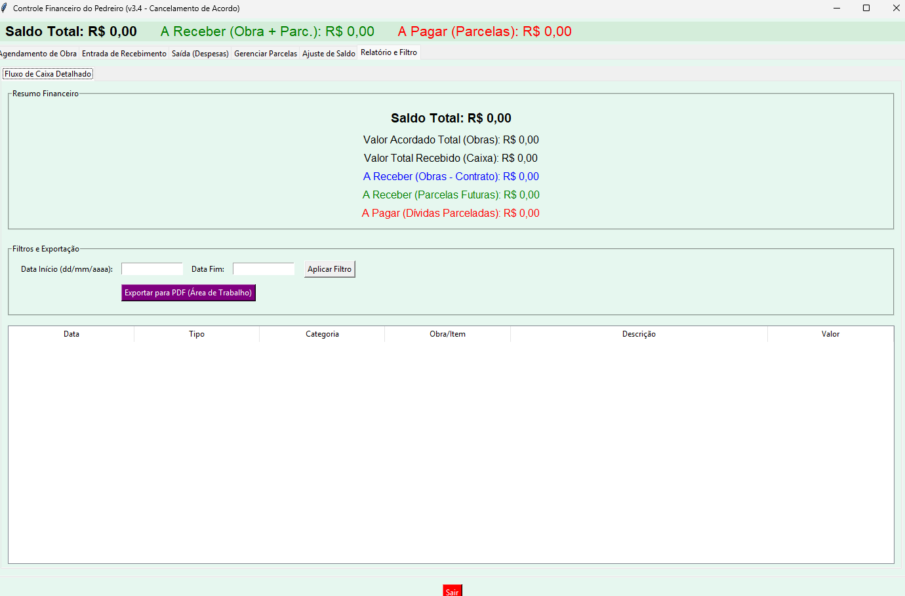
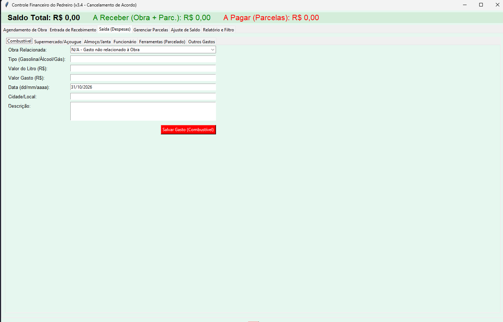
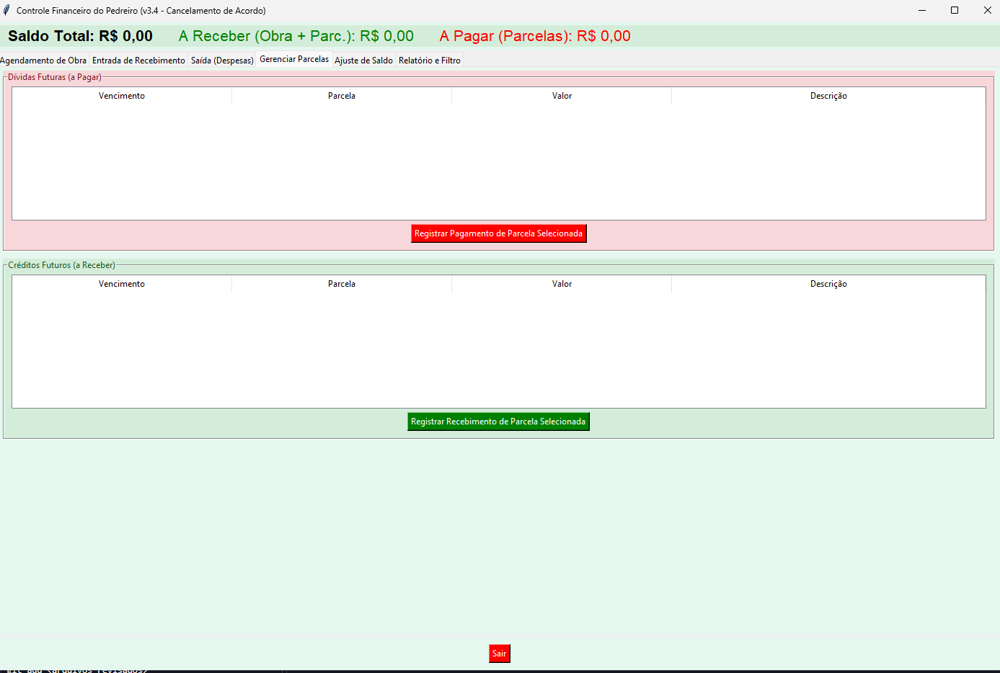

# ObraCaixa — Controle Financeiro para Obras

[](https://github.com/andersonsilvanto/obracaixa/actions/workflows/tests.yml)

Aplicativo desktop para **empreiteiros e pedreiros** controlarem o caixa e as obras
em andamento: quanto entrou, quanto saiu, quanto cada obra ainda tem a receber e quais
parcelas estão pendentes. Funciona 100% offline, sem cadastro e sem dependências externas.

Feito em **Python + Tkinter**, usando apenas a biblioteca padrão.

## Funcionalidades

- **Saldo em caixa** em tempo real (entradas, saídas e ajustes).
- **Agendamento de obras** com valor acordado; o "a receber" de cada obra é calculado
  automaticamente a partir dos pagamentos parciais.
- **Entradas e saídas por categoria**: combustível, alimentação, almoço/janta,
  funcionário, ferramentas e outros.
- **Parcelamento**: a 1ª parcela entra no caixa e as demais viram pendências
  (a pagar / a receber), que podem ser quitadas na aba *Gerenciar Parcelas*.
- **Relatório com filtro** e exportação em TXT para a Área de Trabalho.
- **Ajuste e reinício de saldo**, com histórico preservado.
- Dados em arquivos **JSON** legíveis, com migração automática de formatos antigos.

## Capturas de tela

| Resumo e saldo | Entradas e saídas | Relatório |
|---|---|---|
|  |  |  |

## Como executar

Requisitos: Python 3.10 ou superior com Tkinter (já vem no instalador do Python para Windows).

```bash
git clone https://github.com/andersonsilvanto/obracaixa.git
cd obracaixa
python -m pip install -e .
python -m obracaixa
```

Sem instalar: `PYTHONPATH=src python -m obracaixa` (no PowerShell: `$env:PYTHONPATH="src"; python -m obracaixa`).

### Onde ficam os dados

| Como você executa | Pasta dos dados |
|---|---|
| Pelo código-fonte | `dados/` na raiz do projeto (ignorada pelo Git) |
| Executável do Windows | `%APPDATA%\ObraCaixa` |
| Personalizado | variável de ambiente `OBRACAIXA_DADOS` |

Para fazer backup, copie `transacoes.json`, `pendencias.json` e `agenda.json`.

## Testes

```bash
PYTHONPATH=src python -m unittest discover -s tests -v
```

Cobrem o cálculo de saldo, o "a receber" por obra, o parcelamento, a persistência
em disco, a migração de dados antigos e a validação de datas.

## Gerar o executável (Windows)

```bat
scripts\build_windows.bat
```

O `.exe` sai em `dist\ObraCaixa.exe`. Ele não leva dados embutidos.

## Estrutura

```
src/obracaixa/app.py     # regras de negócio (FinanceiroBase) e interface (AppFinanceiro)
tests/                   # testes unitários
docs/                    # documentação técnica
scripts/build_windows.bat
```

## Documentação técnica

Veja [docs/DOCUMENTACAO_TECNICA.md](docs/DOCUMENTACAO_TECNICA.md): modelo de dados,
tipos de transação, mecanismo de parcelamento e decisões de interface.

## Roadmap

- [ ] Cancelamento de acordo de obra (existe na versão 3.4 documentada; o código-fonte
      desta base é da 3.3 e a função precisa ser reimplementada).
- [ ] Exportação em PDF real (ex.: ReportLab).
- [ ] Aviso de parcelas próximas do vencimento.
- [ ] Filtro de relatório por obra.
- [ ] Backup automático antes de reiniciar um arquivo corrompido.

## Licença

[MIT](LICENSE) © Anderson Lopes Vidal Silvanto
